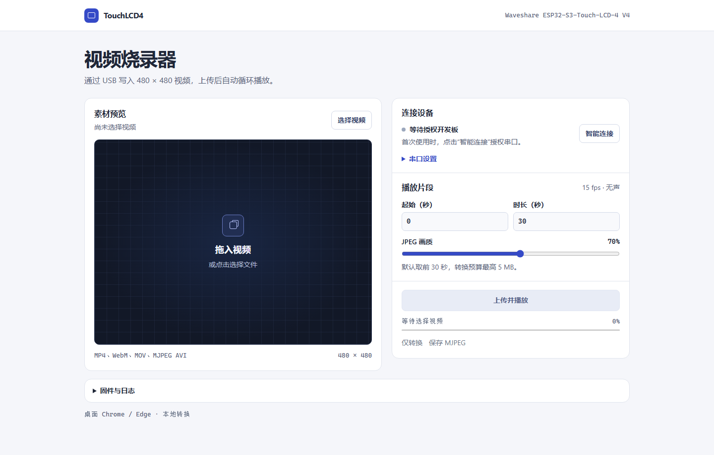

# TouchLCD4 网页烧录器

用 USB 将视频写入微雪 **ESP32-S3-Touch-LCD-4 V4**，上传完成后在屏幕上循环播放。发布版是一个可离线打开的 HTML，视频转换和串口传输都在本机完成。



## 使用

1. 用桌面版 Chrome 或 Edge 打开发布包中的 HTML，再用 USB 数据线连接开发板。
2. 点击 **智能连接**，在浏览器窗口里授权对应串口。已授权设备会在页面打开或重新插入时检测。多台播放器匹配时，可展开 **串口设置** 指定一台。
3. 选择或拖入 **480 × 480** 视频，点击 **上传并播放**。默认从开头截取最多 30 秒，输出 15 fps 无声视频。

支持浏览器可解码的 MP4、WebM、MOV 和 MJPEG AVI。视频有 5 MiB 的转换预算，同时受设备剩余空间限制。空间不足时，可缩短片段或降低 JPEG 画质。

仓库源码构建的 HTML 可以连接已安装配套播放器的开发板。首次安装播放器时，使用随项目单独提供的内置固件版 HTML，在 **串口设置** 中手动指定开发板，然后在 **固件与日志** 中安装。固件适用于使用 CH32V003 的 V4 板卡，配置为 ESP32-S3、16 MB Flash。安装会清除原有视频。

## 本地构建

在项目目录中运行以下命令。

```sh
npm ci
npm run build
npm run dev
```

构建产物位于 `dist/index.html`，可直接用浏览器打开。`npm run dev` 提供预览地址 `http://127.0.0.1:8785`。如果项目目录中有本地 `firmware.json`，构建时会自动嵌入固件。修改源码后重新构建即可刷新 HTML。

| 文件 | 用途 |
| --- | --- |
| `index.template.html`、`styles.css` | 布局与样式 |
| `app.js`、`ports.js` | 页面流程与串口选择 |
| `serial.js`、`video.js` | 串口协议与视频转换 |
| `build.mjs`、`serve.mjs` | 离线 HTML 构建与本地预览 |

## 发布

以此目录作为 GitHub 仓库的根目录。从干净的检出运行 `npm ci` 和 `npm run build`，将 `dist/index.html` 和 `THIRD_PARTY_NOTICES.txt` 随网页发布包提供。公开分发内置固件版时，请同时准备对应固件源码、构建说明和依赖许可材料。

网页依赖的许可文本见 [第三方许可说明](./THIRD_PARTY_NOTICES.txt)。

## 部署到 Cloudflare

部署用 `npm run build:web`，即使目录里有本地固件，也只将网页和第三方许可说明写入 `dist/`。网页通过 HTTPS 提供，浏览器直接完成视频转换和 USB 传输。新网址上首次使用时需要重新授权串口。

| 设置 | Pages（连接 GitHub） | Workers（连接 GitHub） |
| --- | --- | --- |
| 生产分支 | `main` 或实际默认分支 | `main` 或实际默认分支 |
| 根目录 | 留空，源码放在仓库根目录 | 留空，源码放在仓库根目录 |
| 框架预设 | None | 静态资源配置 |
| Build command | `npm run build:web` | `npm run build:web` |
| 输出目录 | `dist` | 由 `wrangler.jsonc` 指定 |
| Deploy command | 由 Pages 管理 | `npx wrangler deploy` |

如果仓库保留了外层目录，根目录填 `TouchLCD4_WebFlasher`。Workers 控制台里的项目名应与 `wrangler.jsonc` 中的 `name` 一致。

也可以在 Cloudflare Pages 选择 Direct Upload，上传 `npm run build:web` 生成的 `dist/`。压成 ZIP 时，把 `index.html` 和许可说明放在 ZIP 根目录。选择 Direct Upload 后，如需改用 Git 自动构建，要另建 Pages 项目。

Workers 也可从本地发布。进入源码目录后运行：

```sh
npm ci
npm run build:web
npx wrangler login
npx wrangler deploy
```

参考 [Pages Git 集成](https://developers.cloudflare.com/pages/get-started/git-integration/)、[Pages Direct Upload](https://developers.cloudflare.com/pages/get-started/direct-upload/) 和 [Workers 静态资源](https://developers.cloudflare.com/workers/static-assets/)。
